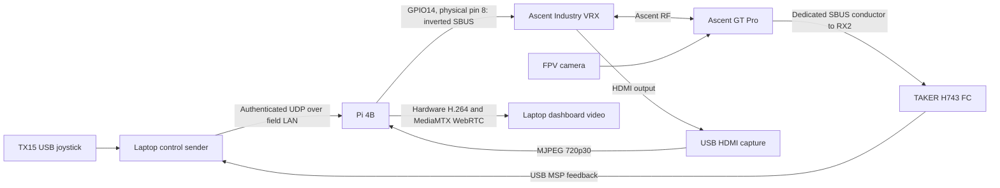

# Ascent mothership relay prototype

Ground-controlled FPV video and RC relayed through a Raspberry Pi and CADDX Ascent receiver, for civilian wildfire-suppression experimentation. One FPV is implemented on the bench; a second independent link and the airborne mothership integration are later work.

**Latency sprint active, 2026-09-29. Start with the [project handoff](docs/PROJECT-HANDOFF.md) and [current measurements](docs/LATENCY-SPRINT-2026-09-29.md).** The player now exposes receive timing and stalls; capture USB reconnects and Wi-Fi interruptions need stabilization before camera-to-screen comparisons. This is a working bench prototype, not a qualified flight-control system.

**[Open Ascent Control Room](http://127.0.0.1:8767/#live)** or use its laptop app launcher. The video-first console has Live, TX15, Calibration and Link views. ARM is a bounded two-second switch test; STICKS and LINK hold all AUX channels low. No RC output starts automatically. See the [operator guide](docs/CONTROL-ROOM.md).

## Implemented bench paths



The Pi generates the SBUS waveform directly for the current finite bench tests. A separate MCU/watchdog, Internet VPN, Starlink backhaul and mothership MAVLink route are **planned**, not installed parts of this diagram. The Pi's HDMI sockets are outputs; its video input is the external USB capture adapter. Native UVC from this Industry VRX has not been demonstrated.

## Verified results and present limits

- SD image write/readback, unattended Pi first boot, pinned-key SSH and automatic video services passed.
- Live GT Pro camera and FC OSD reach the browser through VRX HDMI, USB capture and Pi hardware H.264. WebRTC over UDP was verified in the redesigned dashboard.
- TX15 → laptop → authenticated UDP → Pi → VRX SBUS → GT Pro → FC works. A live HID trial accepted **1,803 frames**, with **1,689 FC observations all disarmed**.
- The owner confirmed that an explicit dashboard SA arming test started the motors and stopped them automatically. FC USB was unplugged for that run, so the motor result is owner-observed, not an MSP trace.
- **45 Python and 4 JavaScript tests passed** at the latest implementation checkpoint. Responsive dashboard checks covered 320-pixel phones through 1920-pixel desktops. The documentation closeout did not rerun hardware tests.
- Full camera-to-screen and stick-to-FC latency, sustained/WAN behavior, electrical margins, RF-outage failsafe and flight operation remain unqualified. See [latency findings](docs/LATENCY.md) and the [chronological evidence](docs/VERIFICATION.md).

## Current access

| Endpoint | Saved/last verified value |
|---|---|
| Dashboard | `http://127.0.0.1:8767/` — laptop only |
| Field Wi-Fi/router | `bbbb` / `192.168.8.1` |
| Pi Alfa Wi-Fi | `192.168.8.175` — DHCP |
| Laptop field address | `192.168.8.130` — DHCP |
| WebRTC | [192.168.8.175:8889/fpv1/](http://192.168.8.175:8889/fpv1/) |
| HLS fallback | [192.168.8.175:8888/fpv1/](http://192.168.8.175:8888/fpv1/) |
| SSH identity | `ascent-pi`; pinned host key, user `ted` |

Use one video viewer when measuring. WebRTC is selected in this laptop's saved settings; fresh console installs now default to WebRTC. The live video target is **720p30 at 1 Mbps**; the reusable capture profile starts at **3 Mbps**. Addresses and physical connection state can change after shutdown.

## Documentation map

| Read when | Document |
|---|---|
| Resuming this project; current truth and next step | [Project handoff](docs/PROJECT-HANDOFF.md) |
| Operating the graphical setup and repeatable tests | [Control Room](docs/CONTROL-ROOM.md) |
| Rebuilding the Pi or identifying image/live differences | [Image preparation](docs/IMAGE.md) |
| Reviewing initial boot, capture and serial setup | [Bring-up history](docs/BRINGUP.md) |
| Checking FC harness signals | [FC wiring](docs/FC-WIRING.md) |
| Reviewing firmware, migrated tune, battery and buzzer changes | [FC 2026 setup](docs/FC-2026-SETUP.md) |
| Reviewing tested SBUS transport and failed UART probes | [SBUS bench history](docs/SBUS-BENCH.md) |
| Understanding video endpoints and access rules | [LAN viewer](docs/LAN-VIEWER.md) |
| Continuing latency work | [Sprint measurements](docs/LATENCY-SPRINT-2026-09-29.md), [earlier audit](docs/LATENCY.md) |
| Understanding design tradeoffs and future WAN/multi-FPV work | [Architecture](docs/ARCHITECTURE.md) |
| Interpreting the supplied command document | [Ascent protocol audit](docs/ASCENT-PROTOCOL.md) |
| Comparing DJI/Avatar/Ascent external control interfaces | [RC-link research](docs/RC-LINK-RESEARCH.md) |
| Checking what was actually tested, in sequence | [Verification record](docs/VERIFICATION.md) |

Earlier documents contain dated checkpoints. Their old “pending” statements describe those checkpoints; the handoff identifies what has since passed. Supplied manuals and the Excalidraw are reference material, not authorization to execute firmware or command examples.

## Development

```bash
python3 -m unittest discover -s tests -v
python3 scripts/preview-console.py
```

The preview at `http://127.0.0.1:8768/` is explicitly simulated and imports no hardware-control modules. A separate software smoke check uses `python3 scripts/fetch.py mediamtx-amd64` followed by `python3 scripts/smoke.py`; it verifies localhost synthetic control and video, not hardware or flight behavior.

Source and repeatable setup are tracked in Git. `work/`, `.cache/`, `dist/`, `local-*.json` and keys are ignored; personalized images, FC backups and credentials must remain private. The [handoff](docs/PROJECT-HANDOFF.md) maps source modules and recovery artifacts.
