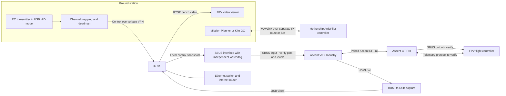

# Ascent mothership relay prototype

Prototype one ground-piloted FPV carried by a mothership, then expand to two independent links. Focus: video, RC control and telemetry transport. Launch mechanics and suppression payloads are outside this implementation.

**Bench status, 2026-09-29:** Live GT Pro camera video and Betaflight OSD now reach the laptop through VRX HDMI → USB capture → Pi H.264 → RTSP. Pi boot/SSH and authenticated software control/loss tests passed. The TAKER H743 runs Betaflight 2026.6.2 with SBUS; UART2 receiver, UART1 DisplayPort, UART4 GPS and the requested saved-tune migration are verified. Four bounded CRSF UART probes in the owner-confirmed `ELRS TT` mode produced no FC channel movement; the FC remained disarmed. A direct inverted-SBUS GPIO14 probe is prepared but has not transmitted. No RC service starts automatically. The USB radio still needs physical stick/deadman calibration. Betaflight buzzer events are currently muted for bench work. See [current SBUS bench test](docs/SBUS-BENCH.md), [FC setup](docs/FC-2026-SETUP.md) and [verification](docs/VERIFICATION.md).

**Local browser viewer:** [FPV video](http://192.168.1.104:8889/fpv1/) · [HLS fallback](http://192.168.1.104:8888/fpv1/). Live camera/OSD verified in both players; read access is limited to the current LAN. See [viewer setup](docs/LAN-VIEWER.md).

**Current design:** Ascent VRX HDMI → USB capture → Raspberry Pi 4B → Ethernet/router → private IP network → laptop. In the other direction, USB HID radio → laptop channel mapper → authenticated control transport → Pi → hardware SBUS interface → VRX → GT Pro → FPV flight controller. The final electrical/control interface remains to be verified on the bench.



The Pi's two micro-HDMI ports are display outputs, not capture inputs. A standard USB UVC capture adapter can ingest the receiver's HDMI output. Native USB video on this Industry VRX has not been demonstrated; use HDMI capture as the baseline. A USB connector used for firmware updates is not proof of UVC capability. [Raspberry Pi display documentation](https://www.raspberrypi.com/documentation/computers/configuration.html), [CADDX firmware notes](https://wiki.caddxfpv.com/zh/Ascent-HD-Series/firmware-release-note).

CADDX explicitly advertises Ascent SBUS/UART passthrough in its firmware notes. The supplied serial-command document covers receiver management; its packet examples operate menus and radio settings. See [the protocol audit](docs/ASCENT-PROTOCOL.md) and [the DJI/Avatar/Ascent control comparison](docs/RC-LINK-RESEARCH.md) for the evidence, remaining interface details and bench test sequence.

## Prepared software

- `relay.video`: explicit capture configuration, H.264 passthrough or encoding, RTSP publication through MediaMTX. Defaults to a clearly labelled synthetic test pattern.
- `relay.bench`: real UDP channel transport with authentication, receiver-clock freshness checks, one operator per receiver run, replay rejection and latched loss detection. Its only output is JSON and SBUS bytes printed as hex. It never opens UART/GPIO or controls a flight controller.
- `relay.joystick`: read-only Linux HID joystick inspection; sender supports four calibrated axes and a held deadman button. AUX channels remain at the bench low value; this is not a completed arming/mode mapping.
- `relay.crsf_probe` and `relay.sbus_probe`: explicit, finite, synthetic probes with throttle and all AUX fixed low. These are bench diagnostics, separate from the HID/network receiver; see [SBUS bench procedure](docs/SBUS-BENCH.md).
- `relay.ascent`: offline menu-packet generation/decoding matched to the supplied examples. It does not transmit commands, pair radios, change RF settings or update firmware.
- A pinned Raspberry Pi OS Lite 64-bit image, installation files, startup services and image/card preparation scripts. Private keys and machine-specific setup stay outside Git.

Read [image preparation](docs/IMAGE.md), [bench bring-up](docs/BRINGUP.md), [architecture decisions](docs/ARCHITECTURE.md), and [verification](docs/VERIFICATION.md).

## Software-only verification

```bash
python3 -m unittest discover -s tests -v
python3 scripts/fetch.py mediamtx-amd64
python3 scripts/smoke.py
```

The smoke test starts temporary localhost processes, passes synthetic channels over UDP, observes timeout after sender shutdown, publishes two test videos and decodes ten frames from each. It closes all processes. This does not verify the Pi, capture hardware, Ascent RF transport, RC transmitter, SBUS wiring or flight behavior.

Owner confirmed the Pi, Industry VRX and VTX are on the bench, with the harness and a switch or portable router available. The SD card is authorized for replacement. Start with one FPV; the second configuration is for later expansion. Shared inventory remains canonical, with no extra Pi count inferred.
