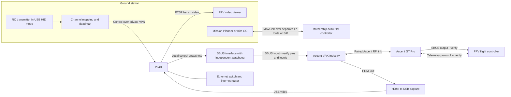

# Ascent mothership relay prototype

Prototype one ground-piloted FPV carried by a mothership, then expand to two independent links. Focus: video, RC control and telemetry transport. Launch mechanics and suppression payloads are outside this implementation.

**Open [Ascent Control Room](http://127.0.0.1:8767/)** or use the desktop launcher. The compact, video-first console adapts to desktop, tablet and phone layouts. **Live → ARM → Start arm test** prepares the relay and indoor profile automatically; **Start again** repeats without rebooting. STICKS and LINK keep ARM locked. TX15, calibration and link settings are separate icon tabs. See [dashboard instructions](docs/CONTROL-ROOM.md).

**Verified 2026-09-29:** TX15 USB → laptop → authenticated IP → Pi GPIO14/pin 8 → VRX SBUS → GT Pro → FC UART2 works. A live HID run accepted 1,803 frames with all 1,689 FC observations disarmed. The new dashboard link check accepted 200/200 frames on the field router. The owner subsequently confirmed that the dashboard SA test started the motors and stopped them automatically. FC USB was unplugged for that arming test, so its actual motor result is owner-observed, not an MSP trace.

**Field network:** SSID `bbbb`, router `192.168.8.1`, laptop `192.168.8.130`, Pi Alfa `192.168.8.175` (DHCP). Both devices autoconnect. The Pi's onboard house Wi-Fi remains a fallback. [WebRTC video](http://192.168.8.175:8889/fpv1/) · [HLS video](http://192.168.8.175:8888/fpv1/). Keep one viewer open. No RC output starts automatically.

**Indoor arming:** the explicit dashboard preparation applies `gps_rescue_allow_arming_without_fix=ON` and DROP failsafe **in RAM only**, with readback and backup of the original values. GPS blocker clearance was verified. Throttle stays at minimum, other sticks centred, SA controls only AUX1; the receiver lowers ARM after two seconds or link loss. Use Restore over USB to reload its original flight settings without rebooting. If the FC loses power, reconnect USB and Start will prepare it again. Verified setup survives console restarts. Props remain removed for these tests.

**Current design:** VRX HDMI → USB capture → Pi H.264 → browser; USB HID radio → authenticated control transport → Pi → Ascent SBUS link → FC. Electrical margins, sustained/WAN latency, RF-outage behavior and full flight failsafe qualification remain unverified. The diagram shows the target architecture with a future independent output watchdog.



The Pi's two micro-HDMI ports are display outputs, not capture inputs. A standard USB UVC capture adapter can ingest the receiver's HDMI output. Native USB video on this Industry VRX has not been demonstrated; use HDMI capture as the baseline. A USB connector used for firmware updates is not proof of UVC capability. [Raspberry Pi display documentation](https://www.raspberrypi.com/documentation/computers/configuration.html), [CADDX firmware notes](https://wiki.caddxfpv.com/zh/Ascent-HD-Series/firmware-release-note).

CADDX explicitly advertises Ascent SBUS/UART passthrough in its firmware notes. The supplied serial-command document covers receiver management; its packet examples operate menus and radio settings. See [the protocol audit](docs/ASCENT-PROTOCOL.md) and [the DJI/Avatar/Ascent control comparison](docs/RC-LINK-RESEARCH.md) for the evidence, remaining interface details and bench test sequence.

## Prepared software

- `relay.console` and `web/`: local TX15 setup dashboard, installed with `python3 scripts/install-console.py`. Preferences and private keys stay outside Git.
- `relay.arm_test`: separate bounded arming receiver. It accepts only fixed minimum throttle, centred sticks, and AUX1 low/high; requires low frames before a rising edge, caps ARM at two seconds, and sends explicit disarm frames at exit. Normal stick tests still reject ARM-high.

- `relay.video`: explicit capture configuration, H.264 passthrough or encoding, RTSP publication through MediaMTX. Defaults to a clearly labelled synthetic test pattern.
- `relay.bench`: real UDP channel transport with authentication, receiver-clock freshness checks, one operator per receiver run, replay rejection and latched loss detection. Its only output is JSON and SBUS bytes printed as hex. It never opens UART/GPIO or controls a flight controller.
- `relay.joystick`: read-only Linux HID joystick inspection; sender supports four calibrated axes and an enable button or switch axis. AUX channels remain at the bench low value; this is not a completed arming/mode mapping.
- `relay.crsf_probe` and `relay.sbus_probe`: explicit, finite, synthetic probes with throttle and all AUX fixed low. These are bench diagnostics, separate from the HID/network receiver; see [SBUS bench procedure](docs/SBUS-BENCH.md).
- `relay.sbus_bench`: finite authenticated UDP → GPIO14 inverted SBUS receiver; accepts four stick channels with all AUX fixed low. Stops on loss or enable release and requires explicit restart. Local socket, physical IP-to-FC and live HID movement tests passed. `config/joystick-tx15-bench.json` records the calibrated AETR sticks and SA-high bench enable.
- `relay.ascent`: offline menu-packet generation/decoding matched to the supplied examples. It does not transmit commands, pair radios, change RF settings or update firmware.
- A pinned Raspberry Pi OS Lite 64-bit image, installation files, startup services and image/card preparation scripts. Private keys and machine-specific setup stay outside Git.

Read [image preparation](docs/IMAGE.md), [bench bring-up](docs/BRINGUP.md), [architecture decisions](docs/ARCHITECTURE.md), and [verification](docs/VERIFICATION.md).

## Software-only verification

```bash
python3 -m unittest discover -s tests -v
python3 scripts/fetch.py mediamtx-amd64
python3 scripts/smoke.py
```

The smoke test starts temporary localhost processes, passes synthetic channels over UDP, observes timeout after sender shutdown, publishes two test videos and decodes ten frames from each. It closes all processes. This does not verify the Pi, capture hardware, Ascent RF transport, RC transmitter, SBUS wiring or flight behavior.

Owner confirmed the Pi, Industry VRX and VTX are on the bench, with the harness and a switch or portable router available. The SD card is authorized for replacement. Start with one FPV; the second configuration is for later expansion. Shared inventory remains canonical, with no extra Pi count inferred.
