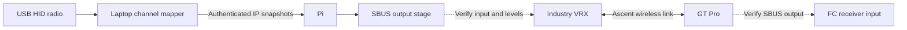

# RC transport: DJI O4, Avatar and Ascent

Reviewed 2026-09-28 against manufacturer documentation. This is a documentation result, not a hardware test. The prepared Pi SD card was not changed or booted during this review.

## Finding

Ascent SBUS/UART passthrough is a documented feature. The remaining uncertainty concerns how the specific Industry VRX and GT Pro implement it, including mode selection, electrical levels and loss handling. Absence of RC packets in the supplied management-command document does not mean absence of RC transport.

SBUS describes the wired channel interface. UART describes serial hardware; it does not identify the application protocol carried on it. A common SBUS output at the flight controller does not establish a common wireless protocol, or a general-purpose bidirectional serial tunnel.

## Manufacturer evidence

| System | Documented behavior | Consequence for this project |
| --- | --- | --- |
| DJI O4 with Goggles 3 and FPV RC 3 | Controller pairs to goggles; goggles pair to air unit. The O4 cable has separate OSD UART and S.Bus/HDL signal wires. | This is the closest architectural analogy to a control uplink through the ground video endpoint. It does not specify an Ascent input protocol. |
| Avatar V2 / Pro | The V2 wiring diagram shows power, ground, TX and RX to the FC, with no dedicated SBUS output on that connector. Supported gimbals have a separate direct head-tracking connection. | Do not assume an O4-style flight-control receiver merely from Avatar head tracking. |
| Ascent | Public V16.4.4 notes add SBUS/UART passthrough, conditional on hardware support. The standard VRX manual calls its six-pin connector a passthrough interface. | Support is advertised, rather than inferred solely from the connector labels. The owner identifies Industry as the standard VRX hardware. |

Sources: [DJI O4 manual, printed pp. 10 and 13](https://dl.djicdn.com/downloads/DJI_O4_Air_Unit_Series/UM/DJI_O4_Air_Unit_Series_User_Manual_v1.0_en.pdf); [DJI binding guide](https://repair.dji.com/help/content?customId=01700011934&lang=en&paperDocType=ARTICLE&re=DK&spaceId=17); [Avatar V2 guide, Connection diagram](https://cdn.shopify.com/s/files/1/0036/3921/4169/files/Avatar_V2-Quickstart_guide-V1.1.pdf?v=1777022512); [Ascent firmware history](https://wiki.caddxfpv.com/zh/Ascent-HD-Series/firmware-release-note); [standard Ascent VRX manual, Introduction](https://cdn.shopify.com/s/files/1/0036/3921/4169/files/Ascent_VRX_User_manual_V1.0.pdf?v=1769739026). CADDX PDFs were located through its [official download center](https://www.caddxfpv.com/pages/download-center). The Avatar filename says V1.1 but its rendered English title says V1.0.

The DJI binding guide separately describes RC 2 binding to the air unit. Do not generalize the RC 3/goggles topology to every DJI generation.

## Why head tracking can be misleading

CADDX documents two routes:

1. Goggles motion → Avatar wireless link → compatible VTX → gimbal UART.
2. Goggles PPM output → radio trainer/DSC input and channel mixer → radio's own RC link → receiver → gimbal via CRSF/SBUS.

The first establishes a supported gimbal uplink; the second uses the RC system. Neither alone establishes arbitrary channel injection through every Avatar VTX. The GM3 V2 manual also limits simultaneous control on its head-tracking UART. [GM3 V2 manual, Head Tracking Function and Product Precautions](https://cdn.shopify.com/s/files/1/0036/3921/4169/files/GM3_V2-20_Manual_V1.2..pdf?v=1784709522).

## What the supplied Ascent package adds

`/home/ted/Downloads/Ascent_V16.5.8_UpgradeFiles/release_note.txt`, items 13–14, explicitly describes Command versus ELRS pass-through mode, with Command as default, and GT Pro head tracking from Ascent goggles. These are separate from the menu/status packet examples in the supplied DOCX.

CRSF is a plausible candidate for the ELRS serial mode, but its framing, baud, endpoint and return direction have not been established for this receiver. ExpressLRS receivers support multiple serial protocols; the name ELRS alone is insufficient. [ExpressLRS receiver serial protocols](https://www.expresslrs.org/software/serial-protocols/).

## Bench implementation decision

Retain this as the first control path to validate:

The application only needs the supported external interfaces; implementing DJI or Ascent's wireless protocol is unnecessary for this design. Video capture and RTSP are independent of generating the RC stream.

Before connecting the Pi output, establish connector direction and signal levels. Use a verified SBUS source to test the Ascent hop independently of IP: compare channel changes entering the VRX with the GT Pro output and the disarmed FC receiver display, with propellers removed. A known-good source can be an appropriate receiver or a measured signal generator; no ownership of one is assumed.

Then test loss separately at the source, RF link, and Pi/network hop. Measure whether the GT Pro stops frames, sets failsafe flags, or repeats old values, and observe the FC response. Only afterward substitute the Pi-generated stream and add the network delay/loss test.

Conventional SBUS is inverted 100000-baud 8E2. A Pi UART configured for ordinary serial is not automatically the correct source; inversion, level compatibility and an independent output timeout need implementation. Do not carry over a DJI Fast SBUS setting without testing Ascent support. [SBUS implementation reference](https://github.com/bolderflight/sbus).

SBUS supplies control channels, not FC telemetry. Establish the UART data mode separately; MSP DisplayPort for OSD, a CRSF link and transparent MAVLink transport are different capabilities. Presently, no bench measurements establish arbitrary UART throughput, simultaneous modes or return telemetry on this Ascent pair.
